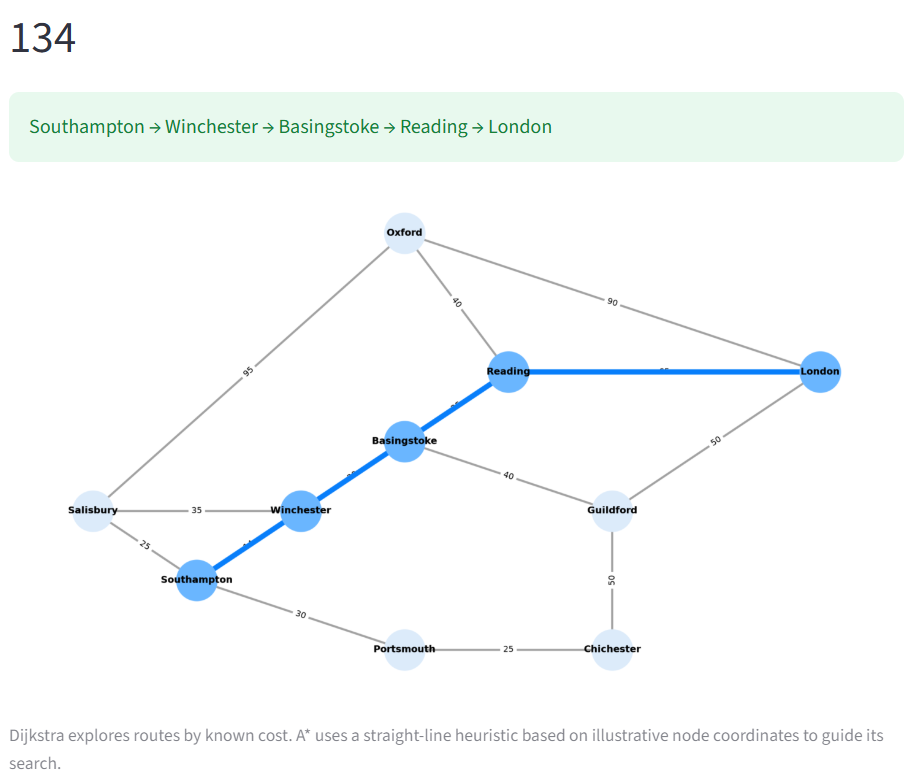

# Route Optimiser 🗺️

An interactive Python application for exploring and comparing shortest-path algorithms on weighted graphs.

Built using Python, Streamlit, NetworkX and Matplotlib.

## Dashboard Preview



## Features

* **Interactive route finder:** Select a starting city and destination to calculate the minimum-cost route.
* **Dijkstra's algorithm:** Finds shortest paths in graphs with non-negative edge weights.
* **A* search:** Uses a straight-line heuristic to guide pathfinding.
* **Breadth-first search (BFS):** Traverses a graph in breadth-first order.
* **Graph visualisation:** Displays the network, edge weights and highlighted route.
* **Algorithm benchmarks:** Compares execution times on randomly generated connected graphs.
* **Automated testing:** Includes 22 tests using pytest.

## Technologies

* Python 3.11+
* Streamlit
* NetworkX
* Matplotlib
* pytest

## Project Structure

```text
route-optimizer/
├── app.py
├── scripts/
│   └── benchmark.py
├── src/
│   └── route_optimizer/
│       ├── graph.py
│       └── algorithms/
│           ├── bfs.py
│           ├── dijkstra.py
│           └── astar.py
├── tests/
├── pyproject.toml
└── README.md
```

## Installation

Clone the repository and navigate into the project directory:

```bash
git clone https://github.com/Jdan345/route-optimizer.git
cd route-optimizer
```

Create and activate a virtual environment:

**Windows (PowerShell):**

```powershell
py -m venv .venv
.\.venv\Scripts\Activate.ps1
```

**macOS/Linux:**

```bash
python3 -m venv .venv
source .venv/bin/activate
```

Install the project and development dependencies:

```bash
python -m pip install -e ".[dev]"
```

## Run the Dashboard

```bash
python -m streamlit run app.py
```

Streamlit will open the application in your browser, usually at `http://localhost:8501`.

Choose a starting city, destination and algorithm to visualise the shortest route.

## Run the Tests

```bash
python -m pytest
```

The project currently includes 22 automated tests covering graph operations, BFS, Dijkstra and A*.

## Run the Benchmarks

```bash
python scripts/benchmark.py
```

The benchmark generates connected graphs containing 50, 100, 250 and 500 nodes, measures median execution time across repeated runs, and verifies that both algorithms return matching shortest-path costs.

For the random-graph benchmark, A* uses a zero heuristic, providing a baseline comparison rather than demonstrating heuristic acceleration.

## Example

For the demonstration network:

**Start:** Southampton
**Destination:** London

One minimum-cost route is:

```text
Southampton → Winchester → Basingstoke → Guildford → London
```

**Total cost: 134**

The demonstration network uses illustrative edge weights and coordinates rather than verified real-world road distances.

## Algorithms

| Algorithm | Purpose                                       |
| --------- | --------------------------------------------- |
| BFS       | Breadth-first graph traversal                 |
| Dijkstra  | Minimum-cost routes with non-negative weights |
| A*        | Heuristic-guided minimum-cost route search    |

Dijkstra and A* use priority queues to explore candidate paths. A* uses Euclidean distance between illustrative node coordinates as its heuristic in the dashboard.

## Future Improvements

* Import custom graph datasets.
* Add larger-scale performance comparisons.
* Introduce real geographical data and calibrated distance heuristics.
* Support additional routing algorithms.

## License

See the `LICENSE` file for details.
